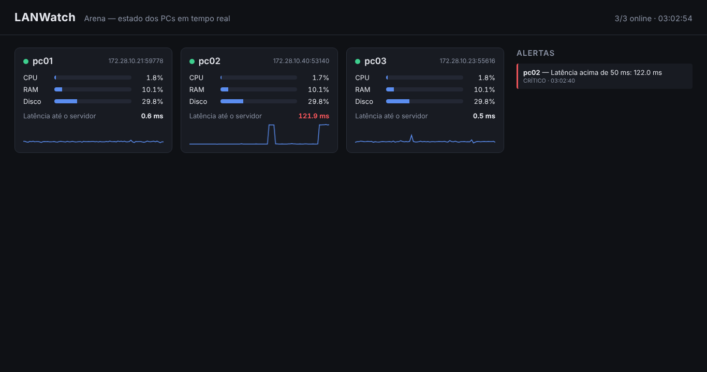

# LANWatch

Monitoramento em tempo real dos PCs de uma LAN house / arena de e-sports.
Projeto final de **PSI129A – Conectividade em Sistemas Ciberfísicos** (PUCPR, 2026/2).

Cada PC roda um **agente Python** (psutil) que envia CPU, memória, disco, rede e latência por **TCP + TLS** a um **coletor central multithread**. O coletor guarda o histórico em SQLite, mostra tudo num **painel web (HTTP/Flask)** e manda **alertas por e-mail (SMTP)** quando um PC cai, trava ou passa de algum limite.



| Serviço | Endereço |
|---|---|
| Painel web | http://localhost:8080 |
| Caixa de entrada dos alertas (Mailpit) | http://localhost:8025 |
| Ingestão dos agentes (TCP + TLS) | `localhost:5000` |
| Descoberta do coletor (UDP multicast) | grupo `239.255.10.10:50000` (só dentro da rede do Docker) |


## Estrutura

```
lanwatch/
├── common/protocol.py      # protocolo JSON Lines (framing, validação de tamanho)
├── collector/server.py     # coletor TCP+TLS: thread por agente, SQLite, logs
├── collector/alerts.py     # regras de alerta + thread que envia e-mail (SMTP)
├── collector/discovery.py  # responde à descoberta multicast UDP (aula 09)
├── collector/web.py        # painel e API HTTP (Flask) + templates/index.html
├── collector/Dockerfile
├── agent/agent.py          # agente psutil: ping/pong, métricas, reconexão com backoff
├── agent/Dockerfile
├── netsim/netsim.py        # proxy TCP que simula rede ruim (atraso) para a falha provocada
├── docker-compose.yml      # rede 172.28.10.0/24: coletor, 3 agentes, mailpit, netsim
├── .env.example            # token compartilhado
└── docs/                   # checkpoint, evidências dos testes
```

## Requisitos

- Docker Engine + Docker Compose v2 (Docker Desktop no Windows já inclui os dois, via WSL 2)
- Para rodar um agente fora do Docker: Python 3.10+ e `pip install psutil`

## Como executar

```bash
cp .env.example .env
# edite .env e coloque um token forte (gere com o comando abaixo):
python3 -c "import secrets; print(secrets.token_hex(16))"

docker compose up -d --build
docker compose logs -f collector        # ver as métricas chegando
```

Parar tudo: `docker compose down` (com `-v` apaga também o histórico).

### Rodando um agente num PC real, fora do Docker

O agente precisa do certificado do coletor para conferir com quem está falando:

```powershell
# Windows (PowerShell), na pasta do repositório
pip install psutil
docker cp collector:/certs/collector.crt .
$env:COLLECTOR_HOST="127.0.0.1"      # ou o IP do PC que roda o Docker, se for outra máquina
$env:TLS_CA="collector.crt"; $env:TLS_SERVER_NAME="collector"
$env:AGENT_TOKEN="<o mesmo do .env>"; $env:AGENT_NAME="pc-rafael"
python agent/agent.py
```

```bash
# Linux / WSL 2
COLLECTOR_HOST=127.0.0.1 TLS_CA=collector.crt TLS_SERVER_NAME=collector \
AGENT_TOKEN=<token> AGENT_NAME=pc-wsl python3 agent/agent.py
```

Se o agente estiver em **outra máquina**, libere a porta 5000 no firewall do PC que roda o Docker. Use só a rede da casa de vocês, nunca a rede da PUCPR (regra 17 do enunciado).

## Variáveis de ambiente

| Variável | Onde | Padrão | Descrição |
|---|---|---|---|
| `AGENT_TOKEN` | ambos | — (obrigatória) | segredo compartilhado do handshake |
| `COLLECTOR_PORT` | ambos | `5000` | porta TCP de ingestão |
| `COLLECTOR_HOST` | agente | `auto` | nome/IP do coletor; `auto` = descobrir por multicast UDP |
| `AGENT_NAME` | agente | hostname | identificador do PC (`[A-Za-z0-9_-]`, até 32 caracteres) |
| `INTERVAL` | agente | `2` | segundos entre envios |
| `CLIENT_TIMEOUT` | coletor | `15` | segundos sem mensagem até marcar OFFLINE |
| `MAX_CLIENTS` | coletor | `50` | limite de agentes simultâneos |
| `DATA_DIR` | coletor | `./data` | banco SQLite e logs |
| `CERT_DIR` | coletor | `/certs` | onde o certificado TLS é gerado (vazio = sem TLS) |
| `TLS_CA` / `TLS_SERVER_NAME` | agente | — / `COLLECTOR_HOST` | certificado confiável e nome conferido |
| `SMTP_HOST` / `SMTP_PORT` | coletor | — / `1025` | servidor de e-mail dos alertas |
| `ALERT_CPU` `ALERT_MEM` `ALERT_DISK` `ALERT_RTT_MS` | coletor | 90 / 90 / 90 / 50 | limites dos alertas |

## Comandos de diagnóstico usados

```bash
docker exec collector ip -4 addr show eth0
docker exec collector ss -tnp state established '( sport = :5000 )'
docker exec pc01 ping -c 3 collector
docker exec pc01 dig collector                              # registro A no DNS do Docker
docker exec pc01 ip neigh                                   # tabela ARP
docker exec collector ip maddr show dev eth0                # grupo multicast (IGMP)
docker exec collector ss -ti state established '( sport = :5000 )'   # RTT/RTO/cwnd do kernel
docker exec collector ps -o user,pid,nlwp,cmd -C python     # NLWP = nº de threads
docker exec -u root collector tcpdump -i eth0 -nn -A 'tcp port 5000'
docker exec collector tail -f /data/logs/collector.log
docker pause pc03      # simula PC travado → OFFLINE após 15 s + e-mail
docker stop collector  # simula servidor fora do ar → agentes reconectam

# rede ruim no pc02 (o pc02 passa pelo netsim):
docker exec netsim sh -c "echo 60 > /tmp/delay_ms"   # ~120 ms de RTT → alerta
docker exec netsim sh -c "echo 0 > /tmp/delay_ms"    # normaliza
# alternativa em Linux "de verdade" (exige o módulo sch_netem no kernel):
docker exec -u root pc01 tc qdisc add dev eth0 root netem delay 80ms
```

## Segurança aplicada

- **TLS 1.2+** no canal agente→coletor, com certificado gerado pelo próprio coletor (chave `600`); o agente confere certificado e nome
- Autenticação por token no handshake (`hmac.compare_digest`)
- Processos sem root (`USER lanwatch` nos Dockerfiles); `/data` com permissão `750`; certificados montados só para leitura nos agentes
- Validação de tipo e faixa de cada campo (TCP e HTTP); limite de 64 KB por mensagem; limite de 50 conexões
